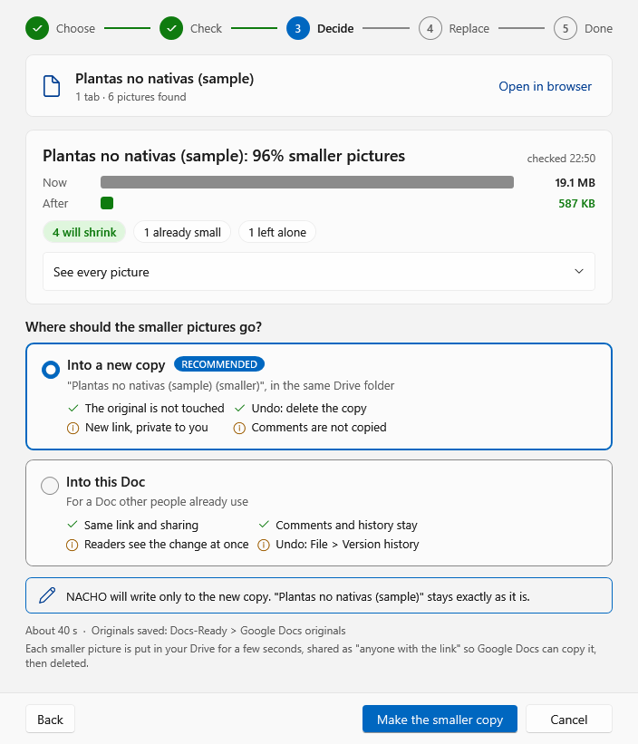
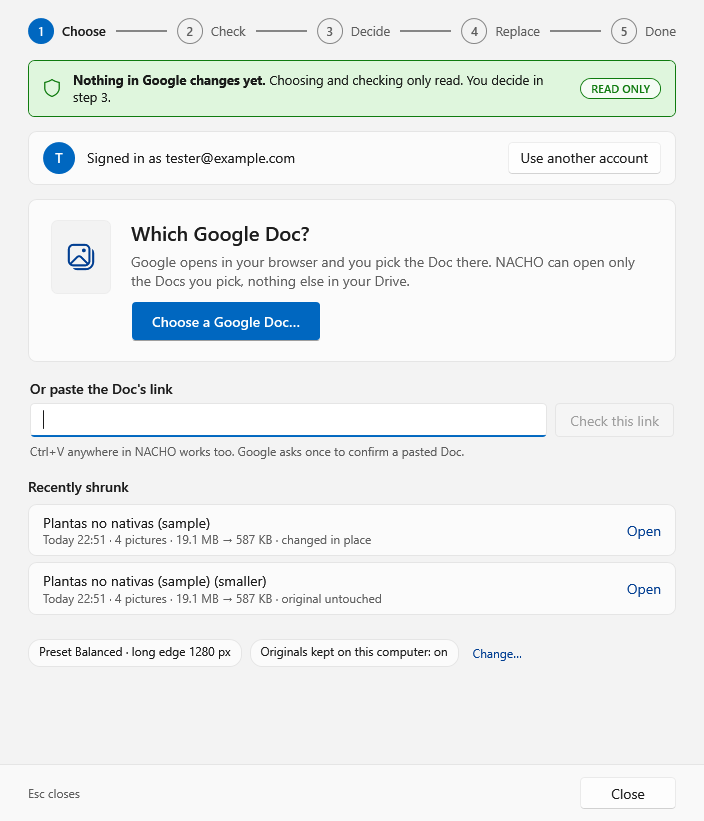
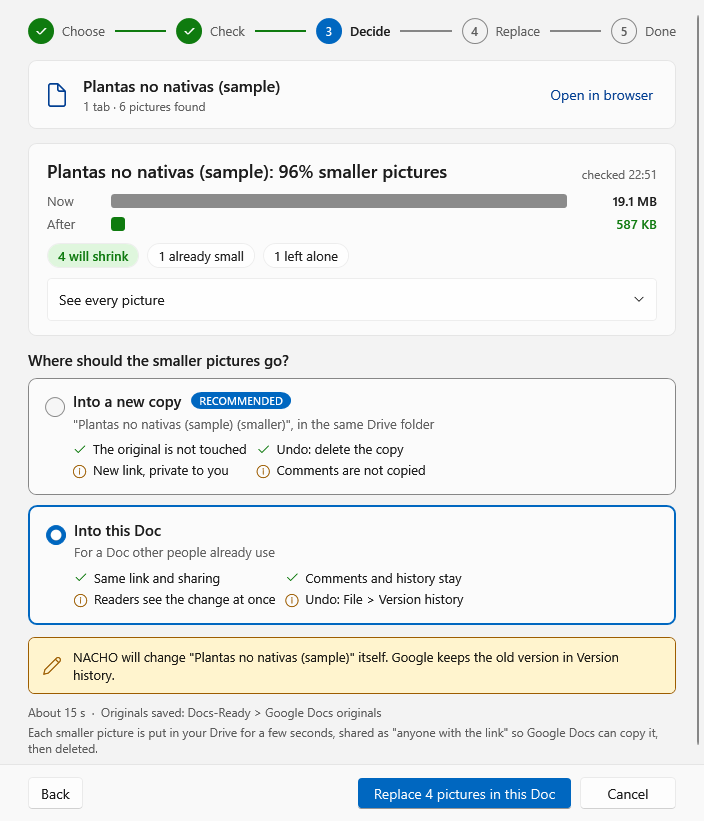
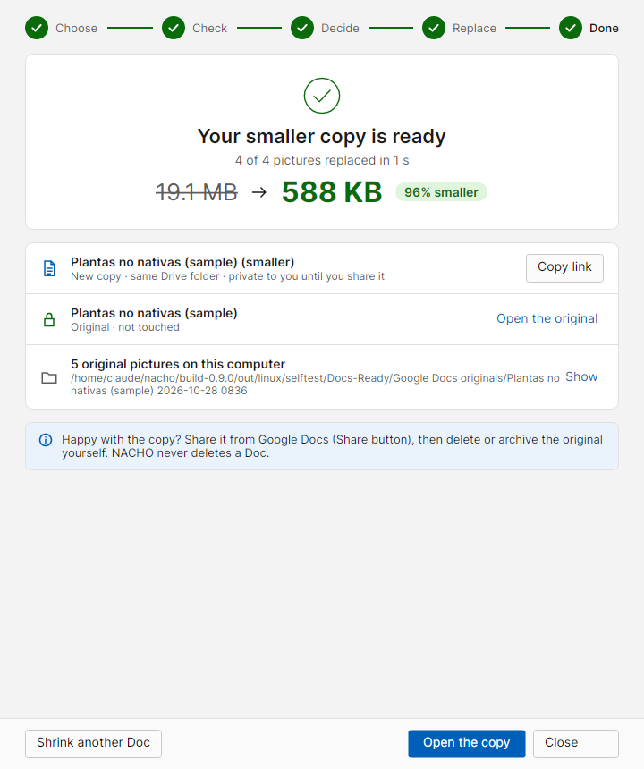
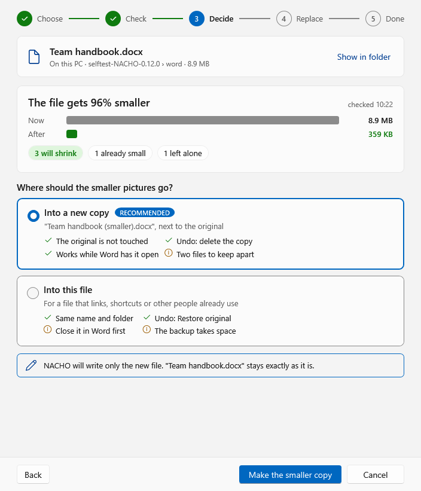
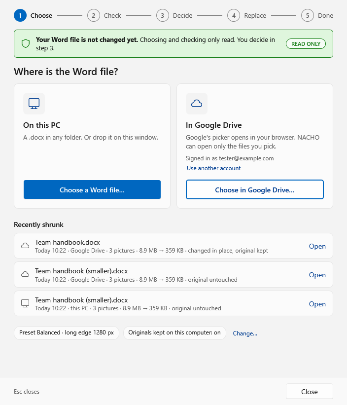
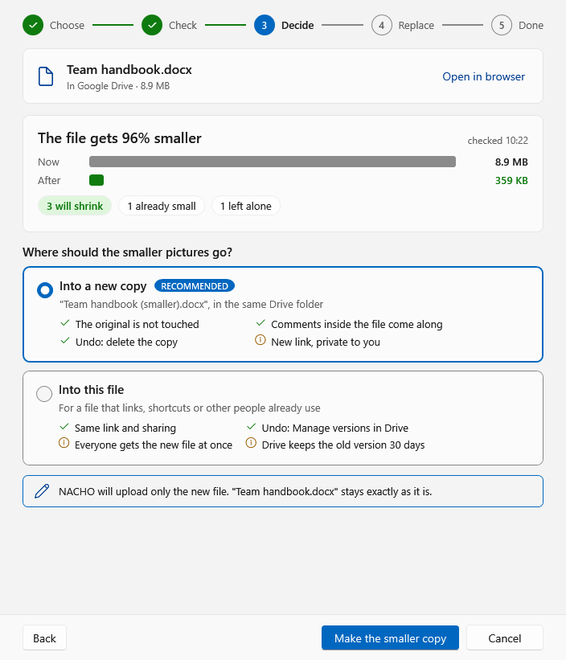
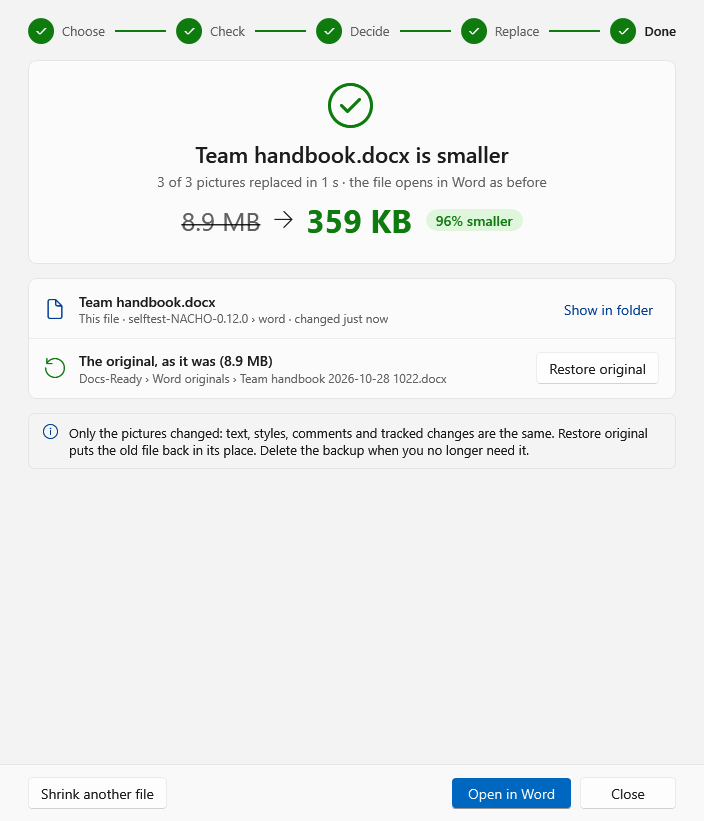
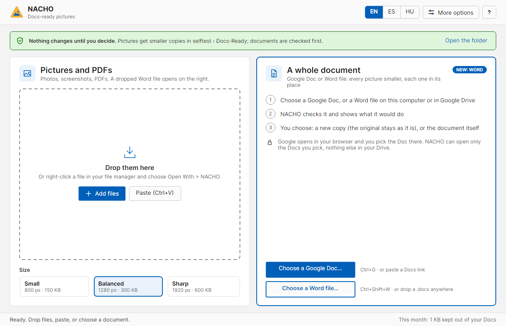

<h1 align="center">NACHO</h1>

<b>Normalise, Adjust, Compress, Hand Over.</b> 
A free Windows and Linux app that makes pictures small enough for Google Docs. 
English, Spanish and Hungarian.

<a href="https://github.com/csabakovacs314/NACHO/releases/latest"><b>Download the latest version</b></a> ·
<a href="https://csabakovacs314.github.io/">Website</a> ·
<a href="https://csabakovacs314.github.io/privacy.html">Privacy policy</a>

## Shrink a whole Google Doc

A Google Doc full of big photos is slow to open and eats your Drive storage. NACHO makes **every picture in the Doc smaller**, keeps each one in its place, and by default puts the result in **a new copy of the Doc**, so your original stays exactly as it is.

A real 410-page book with 251 photos went from **524 MB to 39 MB**.

Five steps, always visible at the top of the window:

| Step | What happens | What can change in Google |
|---|---|---|
| **1 Choose** | Google opens in your browser and you pick the Doc in Google's own picker. Or paste the Doc's link. | Nothing |
| **2 Check** | NACHO downloads the pictures and makes the smaller ones on your computer. You see each picture as it is done, the time left, the free disk space and the connection. | Nothing (the window says READ ONLY) |
| **3 Decide** | See the size before and after, then choose where the smaller pictures go. | Nothing yet |
| **4 Replace** | Both Docs are on screen: the original marked NOT TOUCHED, the copy BEING WRITTEN. Stop (Esc) is safe at any moment. | Only the copy (or the Doc itself, if you chose that) |
| **5 Done** | Open the copy, copy its link, open the original, or show the original pictures saved on your computer. | |

**Where the smaller pictures go**

- **Into a new copy** (recommended, the default): "&lt;title&gt; (smaller)", in the same Drive folder. The original is not touched; to undo, delete the copy. The copy is private to you until you share it.
- **Into this Doc**: for a Doc other people already use. Same link, sharing, comments and history. To undo, use File > Version history.

**What NACHO can reach:** only the Docs and files you pick and the files it makes itself (Google's `drive.file` permission). It never sees your password, never sees the rest of your Drive, and never deletes a Doc. Each picture keeps its size on the page and its wrapping; a Docs crop is cut into the smaller picture, so it looks the same.

## Shrink a Word file (new in 0.12.0)

The same five steps for a Word file (.docx), **on your computer or in Google Drive**. Press **Choose a Word file…** on the start screen (Ctrl+Shift+W), or drop a .docx anywhere on NACHO.

- **Choose:** a .docx on this PC, or one in Google Drive through Google's own picker (NACHO can open only the files you pick).
- **Check:** NACHO makes the smaller pictures in a temporary folder. Your file is only read.
- **Decide:** **Into a new copy** (recommended, the default): "&lt;name&gt; (smaller).docx" next to the original, or in the same Drive folder. Or **Into this file**: same name, folder, links and sharing. On your computer NACHO first saves the original in Docs-Ready\Word originals and swaps in the new file in one step, and only if Word doesn't have it open. In Drive it uploads a new version; Drive keeps the old one in Manage versions.
- **Done:** Open in Word, Show in folder, and **Restore original** for a file changed on your computer.

Only the pictures change: text, styles, comments and tracked changes stay as they are.

## Pictures and PDFs

NACHO opens on a start screen with both ways in side by side: **Pictures and PDFs** on the left, **A whole document** (a Google Doc or a Word file) on the right. Nothing changes until you decide.

- **Single pictures:** drop photos or screenshots (or paste with Ctrl+V, or right-click a file and choose Make Docs-ready). NACHO makes a small, Docs-ready copy in Pictures\Docs-Ready, keeps the shape exactly, removes the location, and never changes your original. Then drag the thumbnail into your Doc.
- **PDFs:** pictures sharper than needed are scaled down; text, fonts, links and forms stay as they are, and every page is checked before the copy is kept.
- **Compare with original** (Ctrl+D) shows the copy and the original side by side with a slider.

## Download

From the [latest release](https://github.com/csabakovacs314/NACHO/releases/latest):

| File | For |
|---|---|
| `NACHO-<version>-setup.exe` | Windows 10 and 11, the installer (recommended). No admin rights needed. |
| `NACHO-<version>.zip` | Everything: the installer, the portable and small exes, the Linux files, licences, source and README. |
| `NACHO-<version>-x86_64.AppImage` | 64-bit Linux, one file: make it executable and run it. |
| `nacho-<version>-linux-x64.tar.gz` | 64-bit Linux with `install.sh` (app menu, Open With and right-click entries). |

Nothing is code-signed, so Windows SmartScreen may warn on the first run (More info, then Run anyway). NACHO checks GitHub once a day for a newer release and shows a link; it never downloads or installs anything by itself.

## More pictures

- [All screenshots, Windows and Linux, in English, Spanish and Hungarian](docs/README.md)
- [What changed in each version](CHANGELOG.md)
- [The user guide (README.txt)](README.txt)

## Build from source

- Windows: `build.ps1` (needs the .NET 10 SDK and Inno Setup). It runs the unit tests and the app's own self-test.
- Linux: `build-linux.sh` (needs the .NET 10 SDK and `xvfb-run`).

The Google sign-in client built into the release is kept outside the source. To build your own copy with Google Docs support, create a Google Cloud "Desktop app" OAuth client and pass its file to the build (or choose it in More options > Google Docs > Advanced).

---

Idea: Csaba Kovacs · Built with Claude. NACHO is not made by or affiliated with Google.
