# NACHO pictures

Screenshots of NACHO 0.12.0 on Windows and on Linux, the design mockups they were built from, and the first mockup from October 2026.

All screenshots are taken by NACHO's own self-test (`NACHO.exe --selftest <folder>` on Windows 11, `nacho --selftest <folder>` on Linux on a virtual X display). It generates its own sample pictures, a sample Word document and PDF, and talks to a pretend Google with a sample Doc ("Plantas no nativas (sample)"), a sample Word file in Drive ("Team handbook.docx") and the account tester@example.com. No real Doc or account is shown.

## Shrink a whole Google Doc

The Google Doc window shows five steps at the top: Choose, Check, Decide, Replace, Done. Nothing in Google changes before step 4, and by default the smaller pictures go into a new copy so the original stays as it is.

### Step 1, Choose

Google's own picker opens in the browser. A pasted link works too. Recently shrunk Docs are listed with Open.

### Step 3, Decide

The size now and after, the counts as chips, and two choices with what each keeps and what it costs. A sentence says exactly what will be written.

In Spanish and Hungarian:

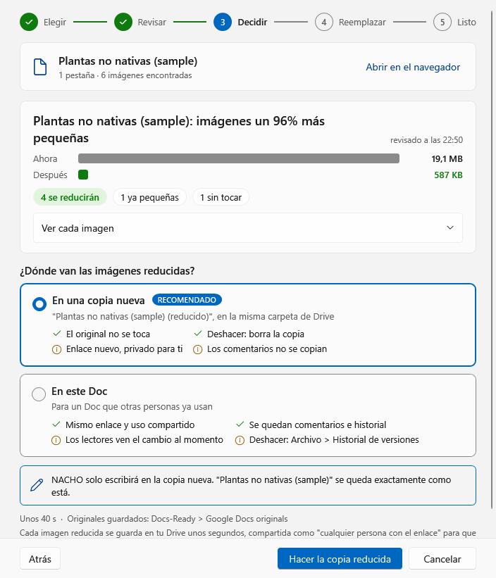 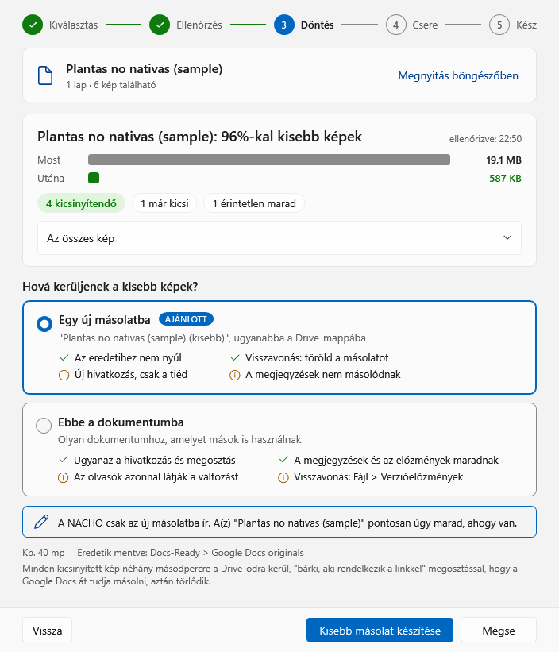

### Step 5, Done

The result in large type, the new copy (with Copy link), the original marked not touched, and the original pictures saved on the computer.

### More options > Google Docs

Signed-in account, where the smaller pictures go by default, keep the original pictures, and the sign-in client.

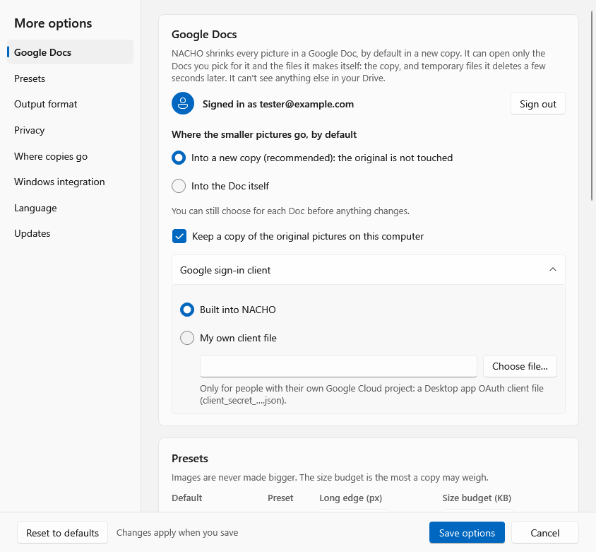

## Shrink a Word file (0.12.0)

The same five steps for a .docx on this PC or in Google Drive. Nothing changes before step 4; by default the smaller pictures go into a new file next to the original.

### Step 1, Choose

### Step 3, Decide

A file on this PC, with Into this file selected: the original is saved first in Docs-Ready > Word originals.

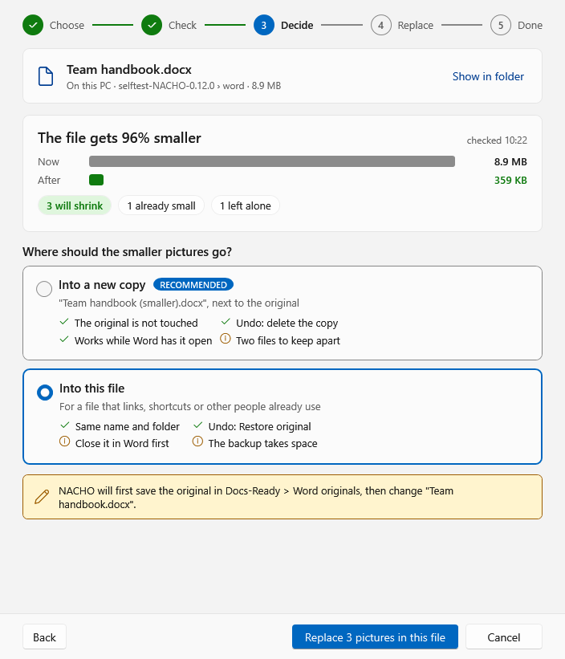

A file in Google Drive: a new copy in the same Drive folder, or a new version of the same file.

### Step 5, Done

On Linux:

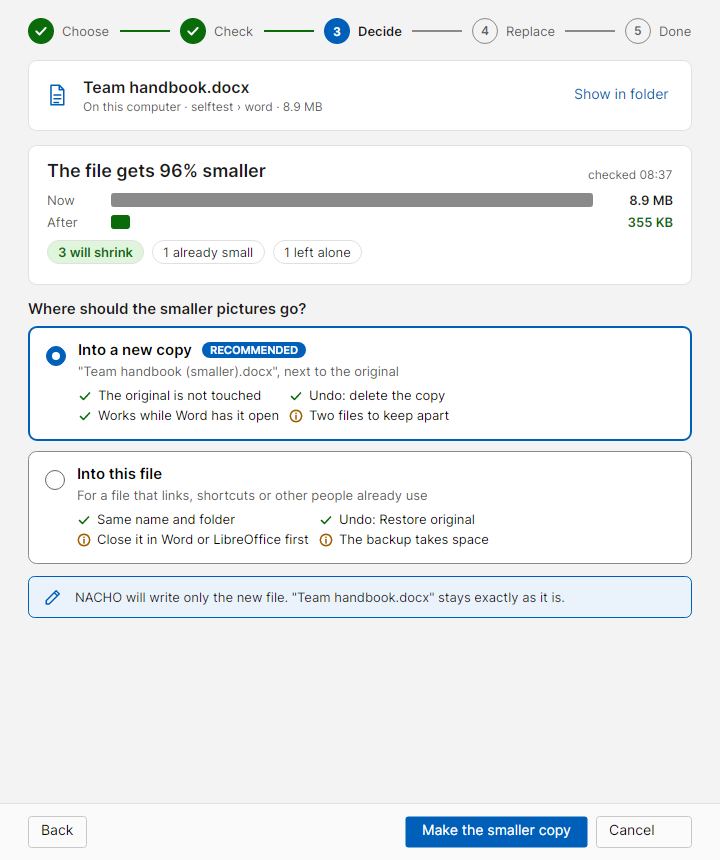 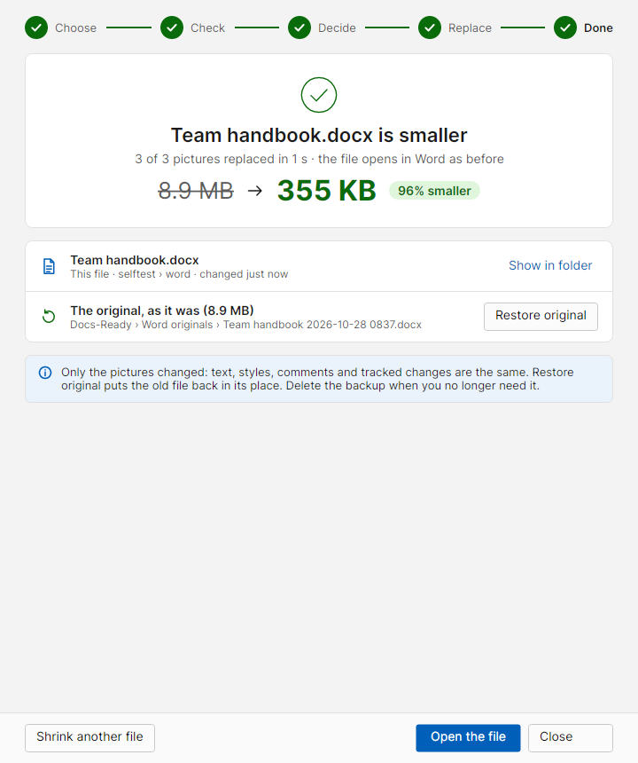

## The main window

### Start: both ways in (0.12.0)

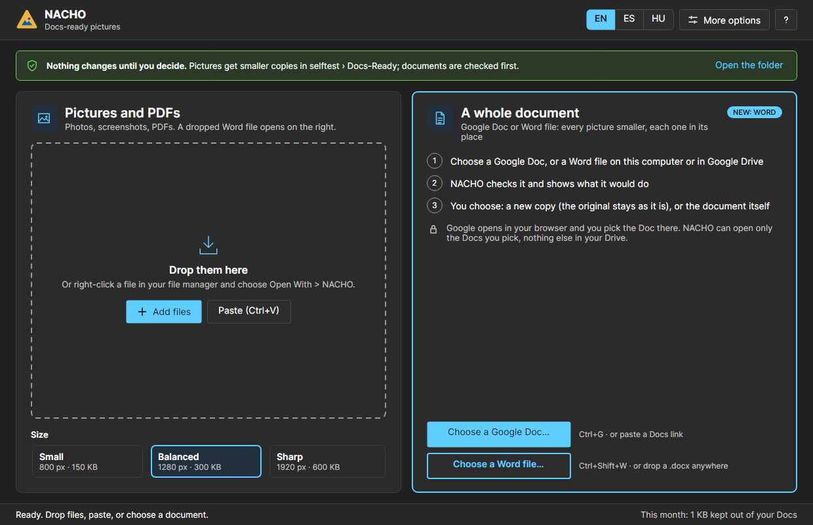

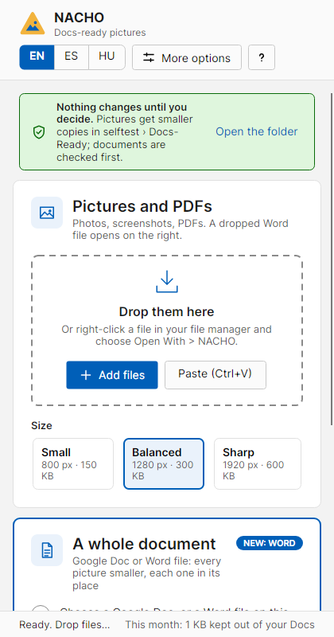

### Results: English, Spanish, Hungarian (Windows)

Each file is a card: the old size struck through, the new size large and green, the percentage smaller, details as chips, Copy file, Show in folder and Compare. The selected card has the accent border; a file that needs attention has an amber border.

### Dark theme and compact layout (Windows)

### Compare with original

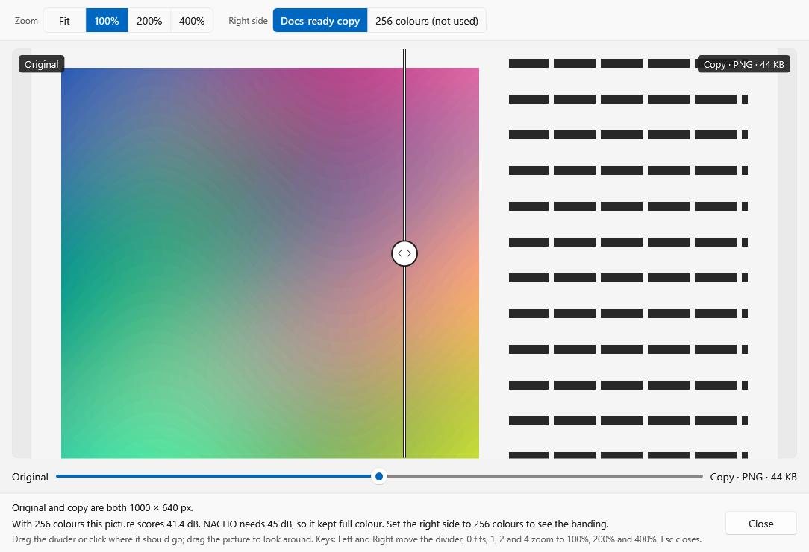

### More options: English, Spanish, Hungarian (Windows)

A section list on the left that follows your scrolling. The bottom bar is Reset to defaults, then Save options, then Cancel.

 

### About: English, Spanish, Hungarian (Windows)

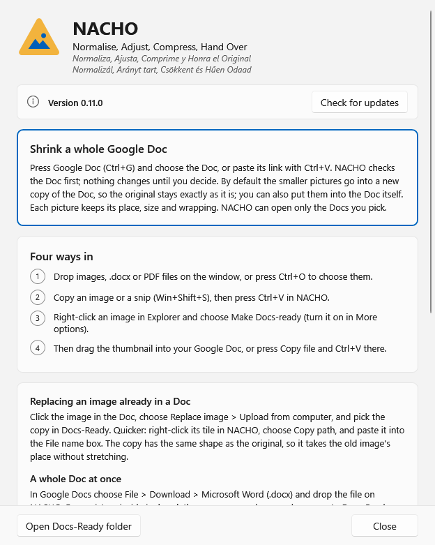  

## The Linux app, version 0.12.0

The same design on Linux (Avalonia). The font is Inter, which ships with NACHO so every distro shows the same window.

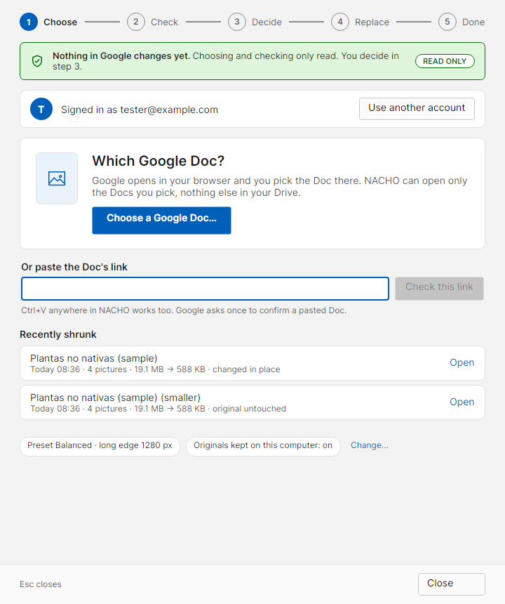 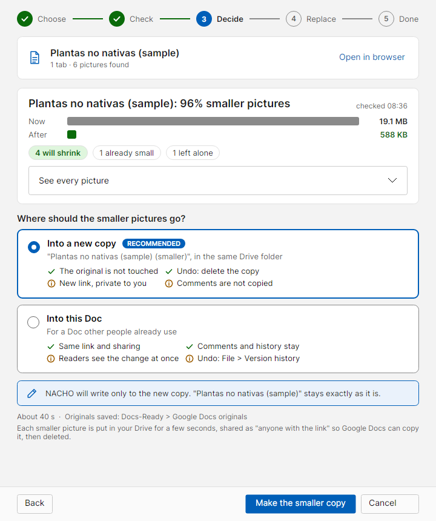

 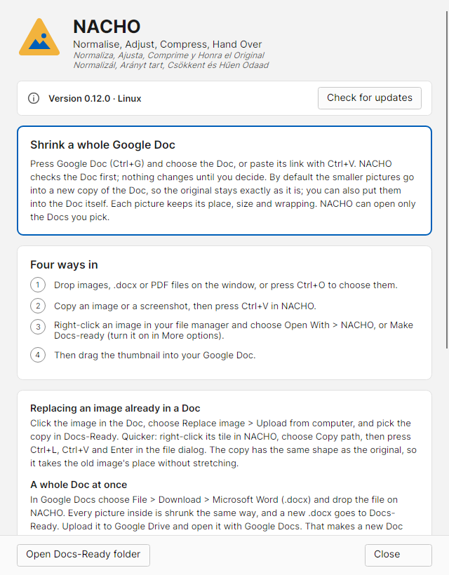

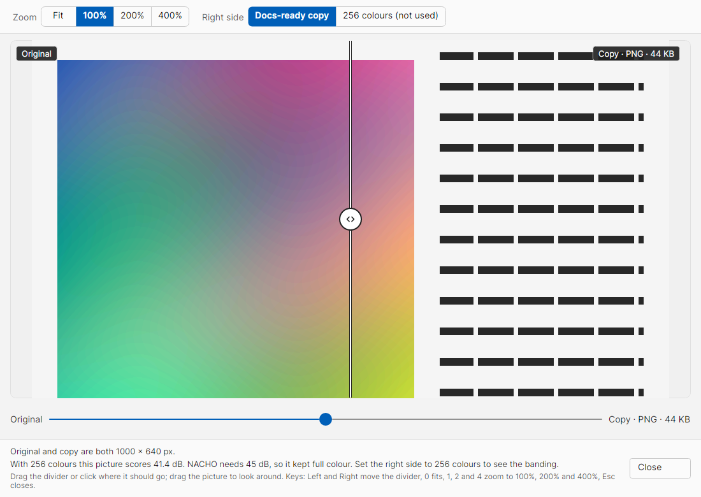

## Design mockups for 0.11.0

Drawn before the code and approved as shown, against Nielsen's 10 heuristics, ISO 9241-110, WCAG 2.2 AA and Microsoft's Windows guidance for commands and dialogs. The font in the mockups is a stand-in.

### Start screen

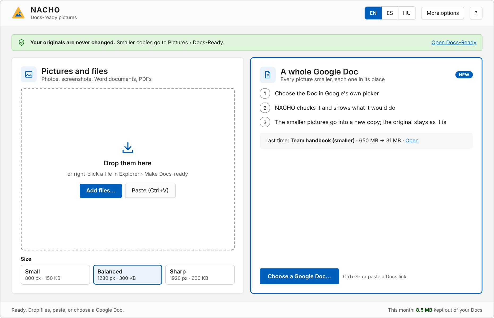

### Results

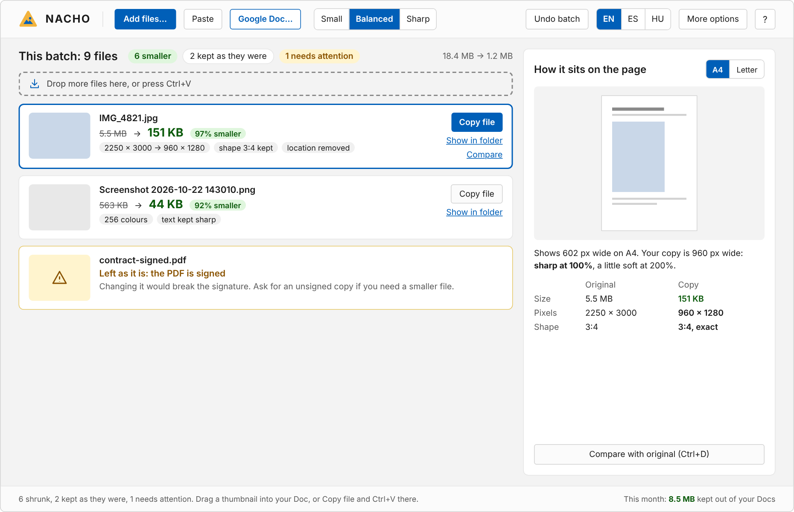

## The first mockup (23 Oct 2026)

What NACHO was first designed from. Some ideas are not built: the clipboard watcher, the first-run tour, the Docs-Outbox folder, tray notifications and "Start with Windows".

 

 
